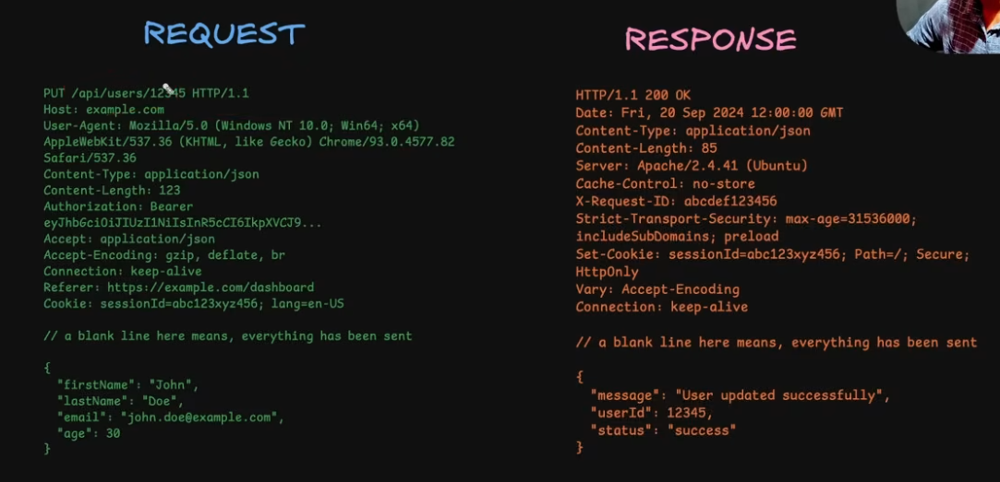
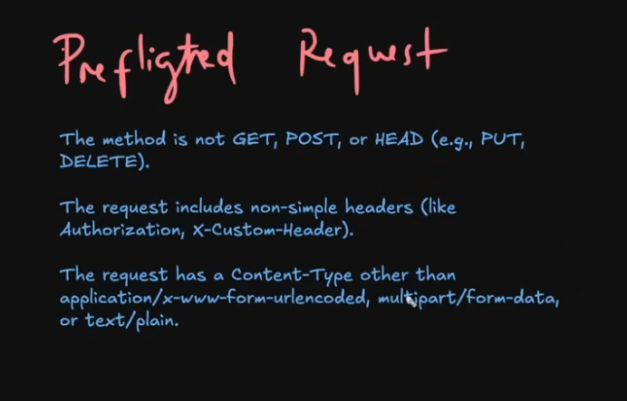
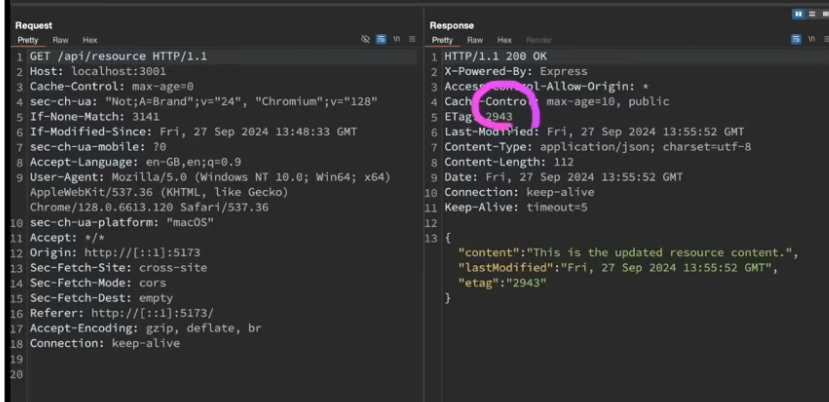
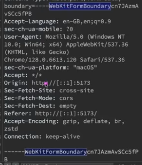

# HTTP for backend

## 1. Core
* Stateless  --- it does not remember about the requests history 
    - simple
    - we maintain state using various techniques when needed (like cookies, tokens etc)
* Client-server model  --- 
    - communication is always initiated by the client
    
## 2. HTTP Basics
* _HTTP Basics:_
    - Https is just more secure http with ssl-certs etc.
    - http uses tcp


* Messages:


* Headers:
    - http headers provide : CONTROL & EXTENSIBILTY

* Methods:
    - IDEMPOTENT ( Get, Put[replaces the data], Delete )
    - NON-IDEMPOTENT ( Post )
    - Patch : appends the data
    - Options: used by CORS {browser follow same origin policy}

* CORS: 
    - browsers allow requests only from the same origin
    - unless preflighted-req or simple-req
    - in case of preflighted-req(3 conditions)
    
    - browser makes and OPTIONS http-req to the asking if it allows that method to that domain or not
    

* Response Code:
    - Response codes are threee digit numbers
    
    - 200 series:
        + 200: request was succesful
        + 201: request was succesful and some new resource was created
        + 204: request was succesful and there is no content to return
    - 300 series:
        + 301: moved permanently 
        + 302: tempporary redirect
        + 304: not modified resource; used in caching
    - 400 series:
        + 400: bad request
        + 401: unauthorized
        + 403: unauthenitcated
        + 404: not-found
        + 405: method not allowed
        + 409: conflict
        + 429: too many request (rate-limiting)
    - 500 series:
        + 500: internal server error
        + 501: not implemented
        + 502: bad-gateway
        + 503: srevice unavailable
        + 504: gateway timeout

## 3. HTTP Caching
done using 304 and etags

- we prefer client based caching now instead of http-based caching
- because if the server fails to update the etag we might still use outdated resource
- whereas client based caching allows us to choose either the cached resource or a new resource depending on our use-case


## 4. Content Negotiation
* using the headers we can select the:
    - language
    - format
    - encoding

* compression:
helps reduce badnwdith usage; depends on encoding types allowed by the client 
* request example with and without gzip


## 5. Handeling Large Req/Res
* Requests: using multipart requests in form of boundary-band



* Responses: using response streaming in form of chunks
  


```
EXTRAS: SSL is outdated security protocol which is now replaced by TLS and HTTPS is just HTTP along with either TLS or SSL.
```