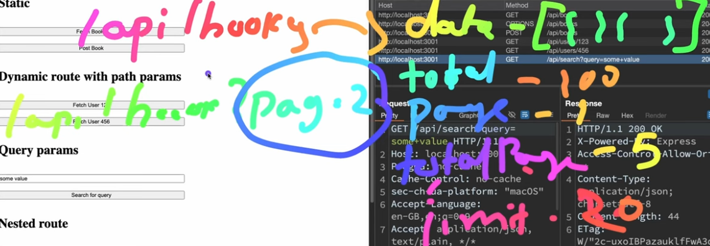

# Routing
* It is basically the "where" of a HTTP-request handling, similar to how the HTTP-method is the "what".

* Method + Route -> is given to Handler of business logic

## 1. Static
* GET     /api/books
* POST    /api/users

## 2. Dynamic
Params are used coz GET methods cant have a body
+ Path params ---> they serve as a semantic expression
    * GET     /api/books/:bookid
    * GET     /api/users/:userid

+ Query Params ---> key-value pairs that are metadata to request
    * GET     /api/search?query=some+value
    * pagination using query params
    

+ Nested route ---> using nested dynamic routes 

## 3. Route-versioning and Depreciation
+ Versioning:
    - /api/v1/products
    - /api/v2/products
+ Depreciation:
    - using versioning concept we can deprecate gracefully while having a grace period
    - this allows smooth migration to new api versions