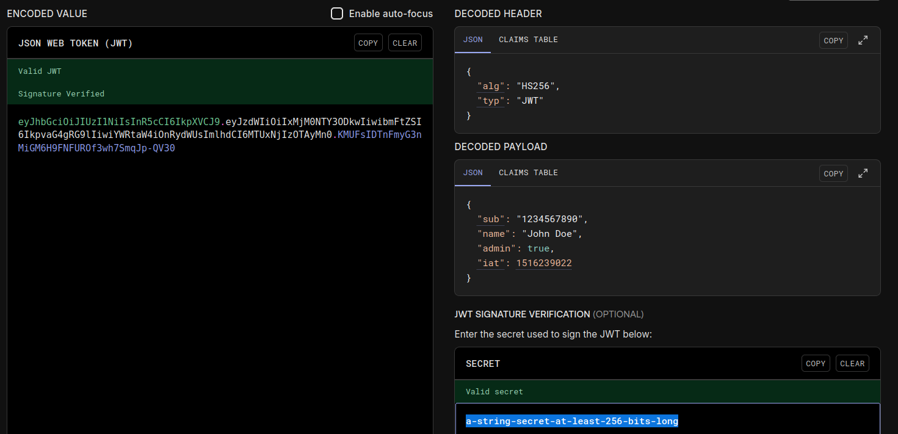
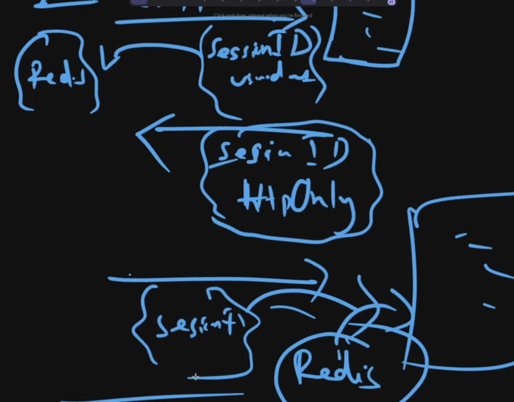
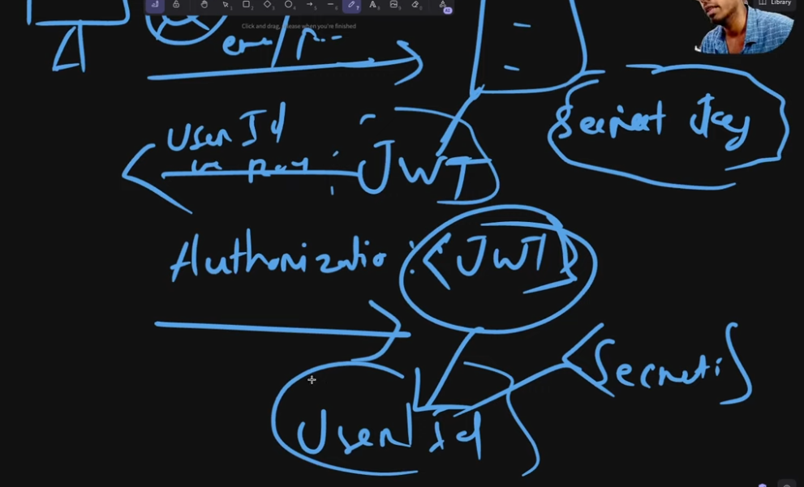
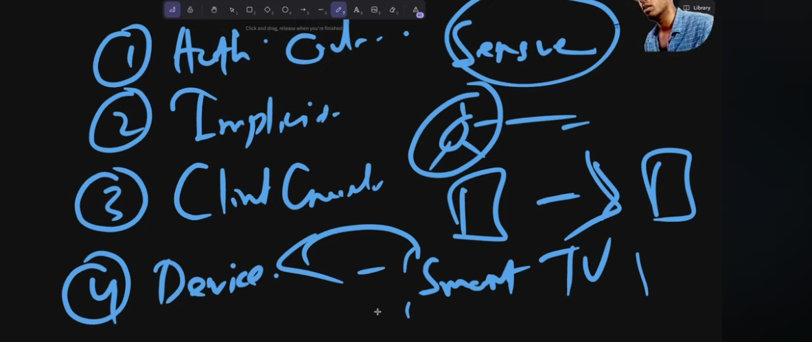
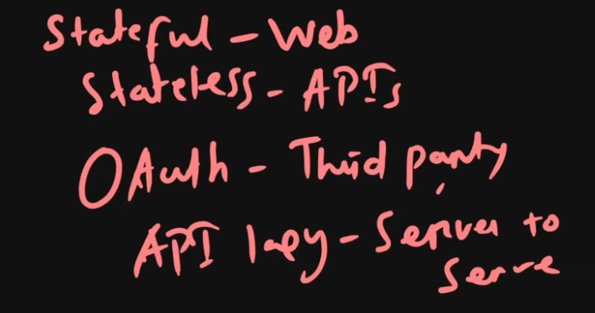

# Authentication and Authorization

* Who are you? --> Authentication
* What can you do? --> Authorization

## 1. Authentication
+ MFA: utilizes 3 elements to make sure of security
    - you know [pin, password]
    - you have [card etc]
    - you are  [retina scan etc]

+ Now we have:
    - OAuth2.0
    - JWT
    - Zero Trust Auth
    - Passwordless

+ Future:
    - decentralized auth
    - behavioral biometrics
    - post quantum cryptography


## 2. Authentication Basics
* HTTP is stateless which was convenient when it is static content.
* Dynamic content(Web2) asked for stateful interactions.
1. **Sessions:** basically establishes temporary data stored in persistence store in the server. This sesId is sent to the user as a cookie. These sessions were short lived. The session data is stored in db(scaling issue) to redis(improved scaling).
2. **JWTs:**
    * Why? 
        - Memory usage by session data was huge
        - Replication
        - Increased latency
    * What?
        - Session verification becomes stateless
        - The verfication logic is combined in the jwt itself
        - 
    * Advantages: 
        - Stateless
        - Scalibility
        - Portability

    * Challenges:
        - Token theft
        - since jwt is stateless it is like dat

    * How to handle the challenges?
        - We use HYBRID approach
        - we store a blacklisted set of JWT-tokens
        - use a external auth provider(OAuth or clerk)

3. **Cookies:**
    * cookies are stored in persistent storage in the user browser
    * they help in auth and tracking user behavior and other metrics
    * subsequent requests attach cookies after the cookie is initialized

## 3. Types of Authentication
### i. Stateful
the sesId is stored by the server in some kinda persistent storage ... db, redis anything

### ii. Stateless
nothing except for the secret key is stored in the server

### iii. API-key
* why?
    - easy
    - good for machine to machine communication
    - stateless
### iv. OAuth2.0 or OpenID-connect
* why?
    - secuirty
    - fatigue
* **DELEGATION problem** --- one platform needed resources of other platform...became a repetitive demand as software complexity grew

* **Open Auth:** Generates tokens with specific permissions, we share these tokens instead of passwords.

* **OAuth1.0 Flow** - it was the initial oauth approach
    1. user gets redirected to the auth-server by the client
    2. user allows specific set of permissions
    3. auth-server generates the token with the required permissions

    * **ISSUES:**
        - complex to implement
        - cryptographic

* OAuth2.0 Features:


* OAuth solved the problem of Authorization and not authentication, that's when people came up with OpenID-connect(OIDC)

* **OIDC:**
    1. added id-token
    2. so we can sign-in from any platform to any platform


* When to use which auth?


## 4. Authorization
Providing specific-permissions to speicific users generates the need of authorisation. Below are some common types of auth-

* **RBAC:** (Role based Access Control) : role is provided by the server and based on that middleware-filtering allows only speicifc-actions to specific-roles.

```
SPECIAL NOTES: dont send specific  messages when auth fails as it increases attack surface; to avoid timed-attacks try to equalize the time
```