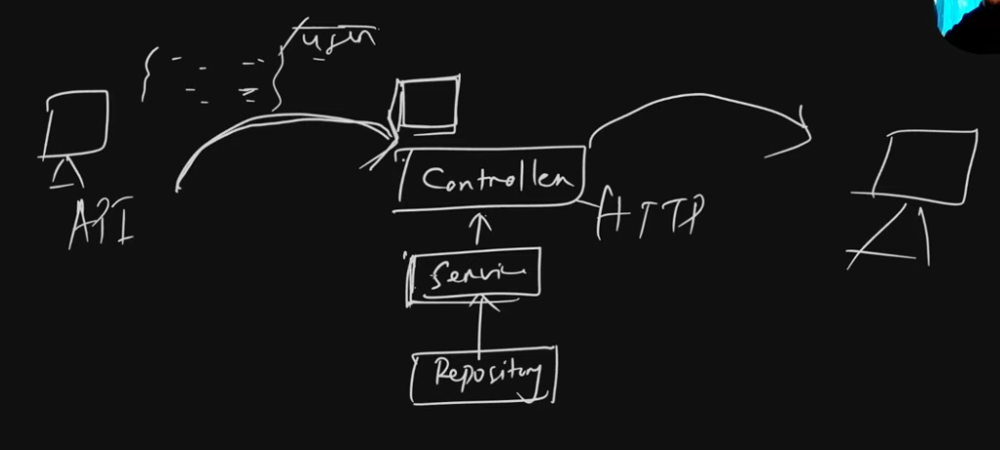

# Validation and Transformation
  
**the small box shows validation & tranformation block

## 1. Types of Validations-
1. **Syntactic**: email, phone, date
2. **Semantic**:  18 < age < 100
3. **Type Validation**: checks-datatype
4. **Complex**: using multiple validations together

## 2. Frontend-Validation vs Server-side-Validation
* We need both as they serve different purpos:
    - Frontend validation provides user-experience
    - Server-side validation provides server-security and data-integrity