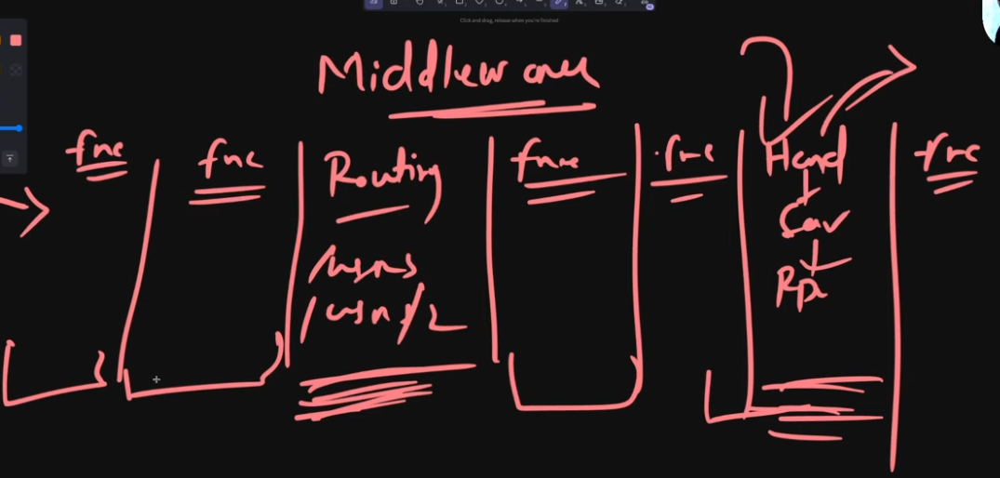

# What are controllers, services, repositories, middlewares and request context?

After the routing of the requests, it is sent to:

## 1. Handler/Controller:
This handles the http-part of the server and calls in the required function from the service layer; below is the flow:
1. **Binding** (Deserialize the request data) --> if fails then 400-bad-request
2. **Validation-transformation** --> keep all query params optional and if it isnt there set it to default value in Tranformation-pipeline
3. **Call the Service layer** --> the service layer should not have ANY http element
```All HTTP-work is reponsibility of the handler layer```
    * **Service-layer implements the business logic, optionally utilizing the Repository-layer** --> the function of the repository-layer is to interact with the db; _a repo layer function should do only one thing_
    * **Service layer returns the response to the controller layer**
4. **Send the response** --> along with status-code

## 2. Middlewares
Middlwares can be anywhere between the pre-discussed architecture(controller-service-repo), can have middleware anywhere.
* Middlwares are optional functions that may or may not be executed

* (req, res, next) -> next passes the execution to the next processing context.

* Why?
    - reusability of same logic without rewriting it (reduces code repetition)

* Where?
    - **Security**: Cors, rate-limit(429), authentication(401)
    - **Logging and Monitoring**: helps in debugging and analysis
    - **Global error handeling**: it is the last middleware(mostly), which takes error from all the middlewares and returns a well-structred response full fo errors to the user
    - **Compression**: used for compressing the data before sending
    - **Data Parsing**:
* Usual ordering of middlwares: CORS -> Authentication -> Logging -> ... -> error handleing
```[the order depends on the usecase]```


## 3. Request Context:
This is a key-value pair and this can be accessed/modified by any of the layer in the request-flow.

```
EXTRA-NOTE: request context is mostly used for auth-data and deadlines
```