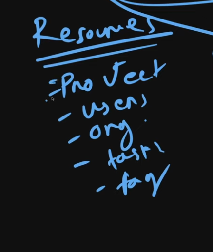
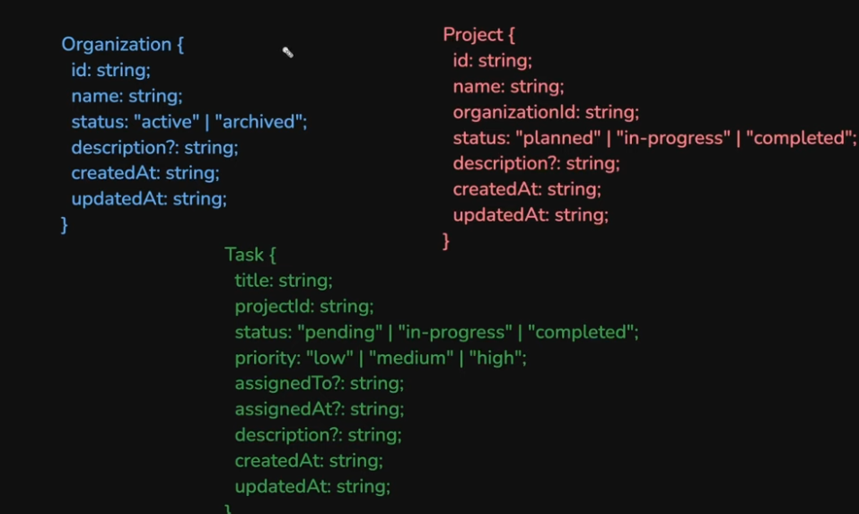
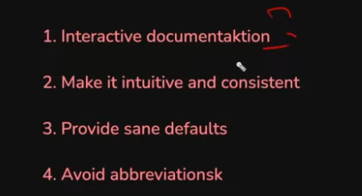

# API Design
```ALWAYS BE CONSIST3NT```
## 1. Why REST?
* Research paper: https://roy.gbiv.com/pubs/dissertation/fielding_dissertation.pdf
* **Representational**: Representation of the data changes on demand. (JSON, XML, HTML)
* **State**: current property of the resource.
* **Transfer**: shows movement of the data resource

### i. URL: 
- green: scheme
- blue: domain
- orange: path
- pink: query-param
- white: page-id
- demo-good url: https://api.example.com/books/harry-potter
    1. sub-domain = api.domain.com
    2. resource   = plural(books)
    3. **hierarchial relationship** with element separated by slashes
    4. downslug the strings: "Harry Potter" --> "harry-potter"

### ii. Idempotency
- it does not matter how many times an idempotent-api is called the response should be the same. (no change in the server with same-api call --- GET, PATCH, PUT, DELETE)

- DELETE is idempotent cause the same delete-request multiple times does not produce any change in the state of the server.

- POST are non-idempotent api-calls.
- Thats why POST is an open-ended method, used for custom-actions like send-email etc.

## 2. API - Design Flow
1. We should start with the wireframe, figma or wutever. We need to identify-
    - Resources(any nouns you can find)
    

2. We move to the db-schema design


3. Define all the crud-actions permissible to the user.
    - **List-resource**: /api/v1/books 
        + should support **pagination** --> _limit(10), page(1)_
        + should allow **sorting** --> _sortBy(created_at), sortOrder(dsc)_
        + should support **filter** --> _resource.Field = FieldValue_
        + if no data --- then return empty list and not a 404, 404 is used only when the client is requesting for a particular entity that doesnt exist

    - **Make-resource**: /api/v1/books
    - **Updating-resource**: PATCH /api/v1/books/:bookid
        + PATCH calls are mostly used as they are used for partial updating of the resource, which is mostly used
    - **Get-an-resource**: GET /api/v1/books/:bookid
    - **Delete-an-resource**: DELETE /api/v1/books/:bookid 

4. Custom Actions:
    - POST /api/v1/resource/:resource-id/custom-action
    - The above path is completely hierarchial
    - Ex: ```POST /api/v1/posts/efdh1h/like```

## 3. What more to do while designing/developing APIs?
