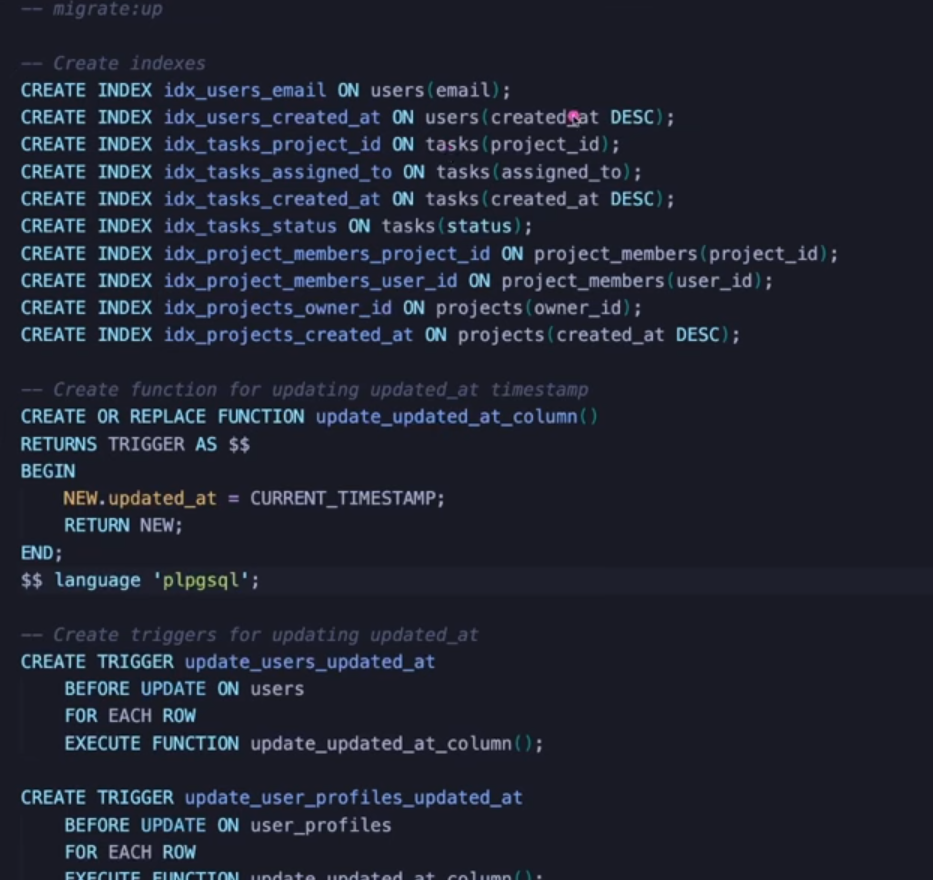

# Databases
Database is some kind of persistent system that allows CRUD operations. For Database in developer context it refers to disks based DB.

* Caching mechanisms store their data in primary memory(RAM) --> speed > capacity
* Disk based databases store their data in secondary memory(disks) --> capacity > speed
* DBMS does: 
    1. Organizatioon 
    2. Integrity
    3. Access
    4. Security

* Why DBMS and not text files? Text files need-
    1. Parsing(error prone and slow)
    2. Structure
    3. Concurrency


## 1. DBMS
### i. Relational
* Uses tables, rows and columns
* Predefined schema
* Data integrity
* we use SQL-query

### ii. Non-Relational
* uses documents
* very flexible schema
* poor data integrity
* we use 


```
We 'll be studying Postgres.(sql-compliant, opensource, VERY extensible, JSON compatible). We 'll be studying only the VERY relevant topics.
https://tableplus.com/ good tool for db query-analysis and vizualizations.
```


## 2. Postgres
### i. Fields
*  
* **Numeric field**: decimal is slower but more accurate (preffered for transactions); floating point is faster but less accurate (used for calculations)
* **String**: TEXT is most modern and preferred >> VARCHAR(maxsize) > CHAR(const-size)
* **Other less used types**: explore the docs for them
* 

```
MIGRATIONS: up-migration applies changes to the db from a list of sql files; down-migration reverts all the changes. [db/migrations/*.sql + CLI-tool(like dbmate etc)]
1. Keeping track of db-changes.
2. Rollback is possible.
```

### ii. Project Example (Project Management System)
+ Create-new-tables.sql --- UP-migration:
    * 
    * use snake_case for names
    * delete constraints (referential integrity constraints): 
        1. RESTRICT: restricts deletion
        2. CASCADE:  cascades and deletes child objects
        3. SET NULL/DEFAULT: on deletion sets cascades and defaults
    * check constraints
    * RELATIONSHIPS:
        1. one-to-one : using pk as fk
        2. one-to-many :
        3. many-to-many : using linking table
    * https://www.geeksforgeeks.org/sql/relationships-in-sql-one-to-one-one-to-many-many-to-many/
+ Create-new-tables.sql --- DOWN-migration:
    * 

+ **SEEDING**: putting some test data for testing the db, have separate migration-files for seeding.
    * 

+ **Paramterized query:** essentially replacing and empty-slot in a sql-query with a string, it can be prone to sql-injections; its mostly done using an orm/db-driver

+ **Triggers**: queries that executed on some other change; updated_time automatically updated when the row is updated.

+ **Indexing**: every time we use WHERE or JOIN or SORT we can choose to index those queries based on the frequnecy of the usage, thus increasing the response-time
