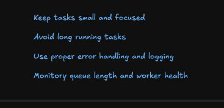

# Background Tasks
Any piece of code that runs outside the request-response lifecycle. (Example sending verifciation emails.)

* Background tasks allow us to offload *time-consuming* and *non-critical* operations, where we can do it with retrial.
* Any background task is sent into the queue for background processing.
* If it fails then its sent back into the queue for RETRYING, some retrial algos are-
    1. exponential backoff (backoff for 1min, 2min, 4min, 8min ...)
    2. dont-retry; push failed in another queue

## 1. When?
1. Sending emails
2. Processing images/videos
3. Generating reports
4. Sending push notifications

## 2. Task-queue
* **Producer** creates a task and pushes it to the queue.
* **Consumer** consumes the task from the queue.
* **Queue** is a broker which stores the task until it can be consumed by the consumer.

* When the task is enqued it is serailized into JSON and when its dequed it is deserialized in whatever form the consumer wants.
* Consumer sends an ACK on succesful completion to the task-queue.
* EXAMPLES: RabbitMQ, Redis-pub-sub, SQS
* **Visibility Timeout**: if a worker doesnt send an ACK till a timeout it sends it to the other-workers till it receives and ACK; so that the task isn't lost.

## 3. Type of tasks
1. **One-off tasks**: tasks that are done once. Ex -- verification emails; reset password; etc
1. **Recuring tasks**: tasks that recur after specific intervals. Ex -- generating reports; stateful-authentication; etc
1. **Chained tasks**: parent-child relationships between different kind of tasks. EX -- uploading-video -> process-video -> thumbanil-video -> process-thumbanail-images (can be parallel)
1. **Batch tasks**: triggering a lot of tasks from the same task; EX -- account deletion grace-period

## 4. Tasks design considerations
1. **Idempotency**: Tasks can be safely executed multiple times without causing any side-effects.
2. **Error-handeling**: To retry failed tasks. 
3. **Monitoring**: To track the status of tasks in queue, failed-tasks, succeful-tasks.
4. **Scaling**: tasks-queeus should scale
5. **Ordering**: background tasks should have proper order
6. **Rate-limiting**: don;t over-request the background queue

### 5. Best Practices:
