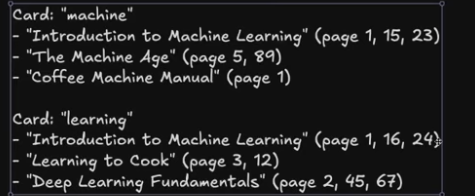
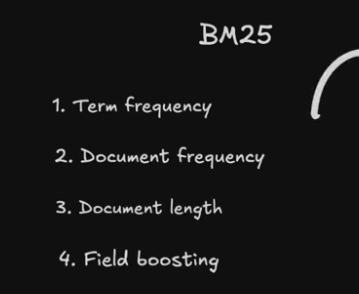

# Elasticsearch
Inverted indexing based tool for text-based search and retrieval.

## 1. Traditional Approach for searching
* Traditional search for a string: 

* This is EXTREMELY-slow, and computationally-exhaustive.
* The search result is not based on relevance.

## 2. Inverted-Indexing/ES-features

essentially we reverse the searching process, by searching for the index instead of the string.
* Elasticsearch also uses a concept of relevance scoring, which gives more relevant search results.
* BM25 algo is used by elasticsearch.
* 
* Elasticsearch also provides type-suggestion/corrections.
