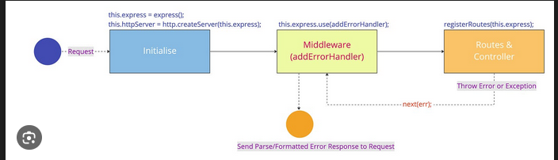

# Error Handeling and Building Fault toleratn systems
Handeling various kinds of erros in our api is very needed for building large scale fault toleratn systems.

## 1. Types of Errors
1. **Logic Error**: very sneaky to find as they quietly cause problem in the logic. When do they happen-
    - misunderstanding requirements
    - implement algorithms incorrectly
    - didnt think about edge cases

2. **Database error**:
    - connection errors (not enough db-pool, db-down, ...)
    - constraint violation error
    - query errors (malformed sql-query, deadlocks, ...)

3. **External Service error**:
    - network-errors
        + connection-timeouts
        + dns-failures
        + network partitions

    - rate limiting (429)
        + we can use exponential backoff strategy to avoid these kinda erros
    
    - service outage error
        + for handeling this : use some kinda fallback

4. **User validation error**: easiest to handle these errors
    - format-validation
    - range-validation
    - required-field validation

5. **Configuration errors**: mostly occur when staging from development to deployment enviornment; can kead to two kind of failing
    - _app fails to start_ : which is good as it verifies configuration before starting the app
    - _app fails in runtime_ : this is bad


```
THE BEST ERROR HANDELING STARTS BEFORE ERROR HAPPENS.
```

## 2. Proactive error detection-
1. **Databases** : check for connection-pools, query working etc 
2. **External services** : check for up-time, rate-limit etc
3. **Core-functionality** : keep checking if they are working or not

## 3. Monitoring and Observability-
It detects errors quickly and helps us fix them. We monitor performance which helps us detect errors before they occur. 
* We can use logging and log-aggregator-tools (like Graphana Loki etc) for monitoring and fixing the errors.
* more about monitoring later.

## 4. Handeling Errors gracefully
1. **Immediate error responses.**
    + recoverable errors
        - sending mails fail
        - not enuff db-pools
        - keep in mind not to overdo it
    + non-recoverable errors
        - containtment and graceful degradation

2. **Error recovery strategies**
    + data should be the most important thing
    + document ur error recovery strategies so they can become standardized and workflows

3. **Error propagation control**
    + catching low level exceptions and bubbling them upwards to high-level exceptions with enough concept
    + (this is called global error handeling)

4. **Global Error Handeling - final safety net**
    + most important error handeling strategy
    + one time investment with very good return


## 5. Global Error Handeling
we need to uplift error in any layer to the ErrorHandler-middleware; this is the FINAL-SAFETY-NET



**ADVANTAGES**:
* more robust and secure
* reducing redundancy

## 6. Security and Error Handeling
1. We need to keep in mind how detailed are the messages that we are sending to the user.
2. so keep the messages geenric in auth-erorr handeling logic
3. authentication is the most targeted module in error attacks (checkout owasp-cheat-sheet)
4. we should use "Invalid username or password" and not specify it.
5. __dont expose sensitive info in the logs.__
