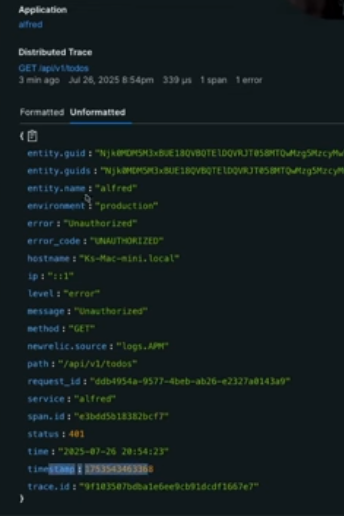

# Logging, Monitoring and Observability
* **Logging**: is recording any/all event with some metadata --> WHAT HAPPENED?
* **Monitoring**: tracking states of our backend applications --> METRICS
* **Observability**: --> TRACES
    - Logs : recorded info
    - Metrics : fixed numbers
    - Traces : trace of error etc

## 1. Logging
Logging is recording all the events that happened.
Log levels:
1. DEBUG: nearly everything ... too much almost
2. INFO: general application logs
3. WARN: errors
4. FATAL: very serious bug

* **Structured logs:** json-logs for production systems; used in produdction environments to allow all the log-management tools for parsing
* **Unstructured logs:** printing human readable text with all the colors and shi; used in development mode to help the developer 

```
Opensource set of tools: prometheus, graphana and jaeger
Simple implementation: using new relic
```

## 2. Monitoring-
actively montiooring the incoming logs and deriving standard metrics from it.
* metrics: actual numbers we can see to quanitfy the effectiveness of our system
* example of metrics: throughput, error-rate etc 

## 3. Observability:
1. **Instrumentation:** practice of measuring different attributes of a function which are closely related to
2. **Open Telemetry:** open standards for software telemtry

Observing traces: 


**this is just a basic intro and a veryimportant part of any production system **