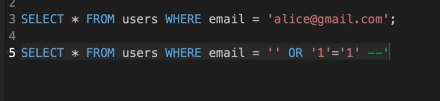
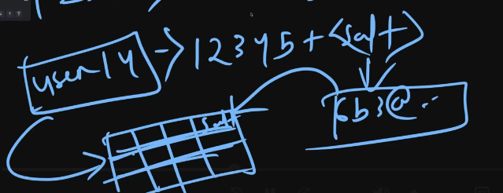

# Security

Attackers ask only one question:
```
Where did the developer make an assumption?
```


## 1. Injection Attacks

our app talks in multiple languages to multiple parts (browser-html/js/css), (db - sql), (os - bash) ... which gives the possiblity of injection attacks of various kinds. It happens when languages cross other language boundaries.
**Be paranoid about user input whenever it mixes with system-commands; use some sort of param-query.**

### i. SQL-injection
injections using which the attackers type malicious SQL code which is taken as input

```SQL
SELECT * FROM users WHERE email="[user input here]"
```


* **FIX** : we use parameterized queries; helps in separating the query from the user input; most orms work like that


### ii. Command-injection
injecting command to harm your operating-system on which the backend-app is running.
```bash
ffmpeg -h 120 -w 120 -o "user input"
```
user-input = ;rm -rf /
* **FIX:** parameterized queries of sort.

---

## 2. Authentication
Avoid implementing the Auth-flow yourself initially. Use an external provider. Coz it:
1. Saves time
2. More secure

Now talking about the auth-security tasks:
1. **Password storage**: don't store the password directly; store its hash
    * storing hash isnt perfect as the hackers try to use *RainbowTable* for predicting hash of common-passwords.
    * so to avoid rainbow-table attacks we use *salting*;
    * 
    * Even after *hashing + salting* there is possiblity of **brute force attacks** due to rise of GPUs etc; dats why we use SLOW-hashing function {bcrypt, sscrypt, anyon2id}
    * for slow-hashing function we can also set the cost factor depending on our system hardware.


2. **Sessions --- Stateful Auth [Preffered]**:
    * Make the sessionIds big-ints(2^128 to 2^256)
    * Database --- (Redis, Postgres)
    * Server sends the sesId to the browser in form of Cookie. These cookies should be-
        - HttpOnly => so that js cant access our session cookies.
        - Secure => so that it uses https
        - same-site => strict, lax, none ::: if its none we it can allow **CSRF** attacks.

3. **JWTs --- Stateless Auth**:
    * JWTs cant be tampered with - by design
    * Revocation of JWTs is hard; which is due to the stateless-auth. Fix:
        1. Blacklisted tokens
        2. Short expiration refresh token
    * Where should we keep the JWT? can;'t keep it in memory; so either refresh-tokens in db and auth tokens in browser-cookies

4. **Rate-limiting**:
    * very important for authentication-workflows
    * recommended to have multiple layers of rate-limiting.
        - L1: Per-IP {can be skipped by botnets etc}
        - L2: Per-account {can be skipped by using same password for multiple accounts}
        - L3: Global-rate-limiting, using captcha...

---

## 3. Authorization
few famous auth-level vulnerabilities
1. **Broken Object Level Authorization**: (BOLA)
    - _FIX_: instead of just authorization check in the Routing-layer do it down to the Repository-layer. (granular authorization)

2. **Broken Function Level Authroization**: (BFLA)
    - using a separate url for admin-level access
    - "secuirty thru obscurirty" is not security

3. **Indirect Object Level References**: (IDOR)
    - accessing enumerable objects --- /books/10001
    - _FIX_: use uuids


**FIXES:**
1. centralize authoirzation
2. default deny
3. test custromization specifically
4. have a automated auth-test suite
5. audit logs

---

## 4. XSS
If the attacker is able to run some JS-code in the users-browser from the context of our application. [dats why keep the cookies httponly]. What the XSS attack can do -
1. phishing
2. non-httponly cookie stealing
3. make your website look completely different

**CAUSE**:
1. user defined content is being trated as code rather than data

**PREVENTION**
1. sanitization
2. CSP --- content security policy --- dont run inline scripts etc

## 5. CSRF
It works because of the cross site nature of the cookies.

unless __samesite:=none__ we are safe from the csrf attacks
---

## Practices that cause a insecure system
1. Misconfigurations
2. DEBUG mode in PROD
3. Security headers (CSP, x-frame-option)


```guidance
While writing code everytime ask yourself:
    1. Where is the data crossing the boundary?
    2. What assumptiona am I making about the data?
    3. What happens if those assumptions are wrong?
```
