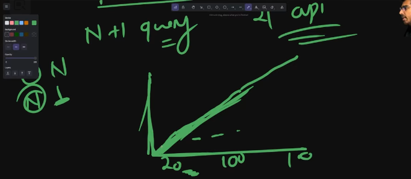
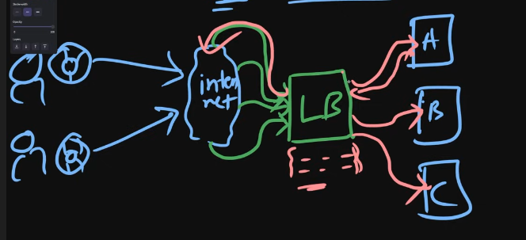
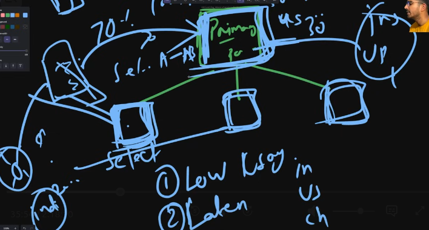

# Backend Scaling and Perfomance Engineering

## 1. Performance metrics:
* **Latency**: essentially how much time it takes to process a request; average is a bad measure of latency so we use percentile.

we need to take care of of p99, p95 latencies as those are real-users of our app making complex requests.

* **Throughput**: how many concurrent requests can we handle; a combined understanding of both is very well needed in order to understand performance.

* **Utilization**: how much of the system we are using; if we try to exhaust the same system the wait time increases

    - Thats why we should never use a system on 100%utilization
    - traffic comes in burst and is not constant (like real world traffic)

```Performance = low latency + high throughput```

* **Bottlenecks** : if a ssytem is _slow_ then we need to find the bottleneck and approach a problem specific solution instead of using a generalized solution

* **Profiling**: process of profiling the call-stack timing of the server; _Flamegraph_ is a good tool; helps in identifying the point of bottleneck; good in measuring cpu-bound task and not so good in io-bound task
    - _Distributed tracing:_is good for finding bottleneck in io bound tasks. 

## 2. Database problems
dtabase is the cause of msot bottlenecks; some common db-performance problems are;
1. **N+1 query problem** [QUERY]==> ; FIX: we fetch data in bulk
2. **Indexes** [INDEX] ==> the lackof indexes can cause issues; so monitor your db-requests and determine good index-targets; some problems of index : {1. memory, 2. syncing-crud-operations}; so be very cautiaous while defining indexes
3. **Cost of Db-conenctions:** [CONNECTION]==> the db-connection is a big overhead at scale; so we prefer using connection-pooling
    - we maintain pools of connection
    - when making a request the server asks for a connection from the connection-pool
    - after the request is completed the server returns the connection back to the pool
    - in order to avoid pooling-overload we use an external pooler(ex. PGbouncer); so we dont exhaust our pools
4. **Caching:** [CACHING] ==> we cache any costly-repetitive request; the problems with caching is
    - i. Cache-invalidation: {time-based, event-based}
    - ii. Storage? where do we store our cache ... local(each server) or distributed(redis) ::: local has problem of consistency among different servers
    - iii. patterns: lazy-caching/write-thru/write-behind
    - cache-hit-rate: very important metric which helps us identify a good caching algo and pattern [good: 70-80%]
    - What negatively effects our cache enteries?
        1. TTL
        2. Cache-size
        3. Data Access Patterns

## 3. Scaling:

### i. Server-Scaling
1. **Vertical Scaling** [scaling up --- making our server more and more powerful]; this is limited by hardware limits
    - CPU
    - Memoru
    - Storage
    - network card [more capability to handle traffic]

2. **Horizontal scaling** [adding more instances to your server]; this is limited by complexity
    - geo-distrution
    - redundancy
    - not-limited by compute
    - *STATELESSNESS*

#### Load balancers
These are part of horizontal-scaling setups and they forward the request to the distributed servers:

**LB-ALGOS:**
1. **Round-robin**: ideal when all servers have same amount of compute-power
2. **Weighted round-robin**: used when different servers have different compute powers
3. **Least Connection**: sends the request to the server with the least amount of connections
4. **Least Response Time**: sends request to server with least response time

LoadBalancer keep sending /health request in order to decide if a server is healthy or not.

### ii. Db-Scaling
1. **Read-Replicas**: a master reference has a number of child references and the child-db-nodes only serve READ-requests
    + 
    + ADV: low-latency
    - DIS: consistency
2. **Sharding**(Partioning): parting the data in shards[multiple physical dbs] to reduce search space [ex. geolocation based sharding we dont have to search for an indian user in all the servers]

3. **Distributed dbs**: realistically we use this; it takes care of sharding, replication and distribution by itself
    - AWS - S3
    - Neon4j ... etc

4. **CDNs**: bringing the static-files closer to the user also reduces db-load:
    - CONTENT: static-files, api-replies, cloudflare-cdn for ddos prevention, edge-computation {provides a lot of use-case }

## 4. Microservices
* **Monolith** is an application design where every element of the application is in one place, which causes the following problems:
    1. **Deploy**: miscroservices can have an easier distrbuted deployment
    2. **Scaling**: we can scale the micorsservice depending on the usage
    3. **Organization** 

* ISSUES of micorservicce based architecture:
    1. Network/Latency issues
    2. Complex debugging
    3. data consistency

* WHEN?
    1. Large team
    2. Scaling needs
    3. Different Technology is needed

## 5. Serverless
Serverless is essentially we only care about writing about the application logic and not about the scaling etc. It autoscales depending on the incoming request --- this is very useful when we dont know the amount of user traffic that can come. Issues:
1. **Cold-start times**: the first request is slow
    - keeping few requests ready 
    - runtime with min-cold start{v8, kvm ...}
2. **Limits**: the max amount of request is fxed
3. **Always-on Cost**: min-Lambda instances that are running
EX: AWS-lambda, 

Advantages:
1. Autoscaling
2. Very-cheap

* When NOT to use? latency based applications
* When to use?     video-processing, event based operations

## 6. Mental Model for Practical Development
1. Problem --- **what is the bottleneck?** [dont optimize the app without knowing this - thats premature optimization]
2. **Simple Solutions**
3. **Scale for the problems you have**
4. **Measure your systems**
5. Mindset

```
COMPLEXITY HAS A COST. Every new component for a solution is a component that can fail and that you have to monitor.
```
