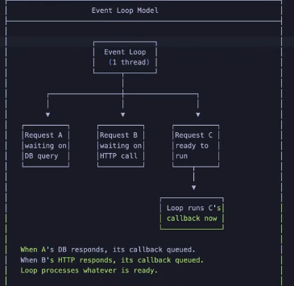
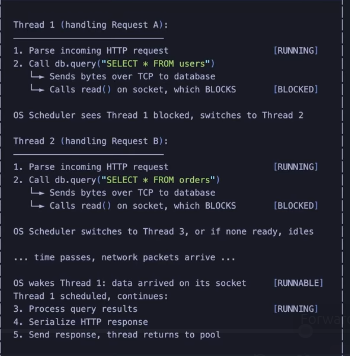
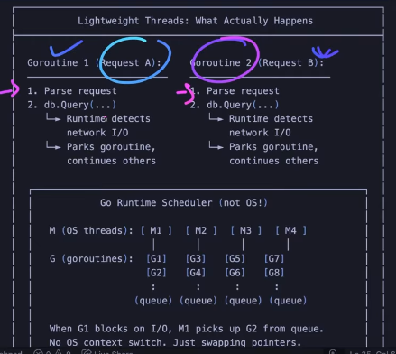
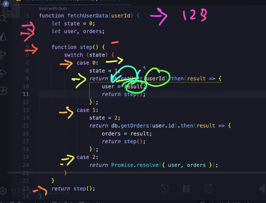
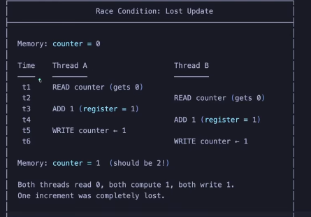

# Concurrency And Parallelism
* **Concurrency**: doing multiple things at once; we use 1 core at a time; so it uses context switching; *dealing with multiple things at once* ---> I/O-bound processes
* **Parallelism**: executing mutliple instructions at the same time; we need hardware level support for this; it needs multiple core; *doing with multiple things at once* ---> CPU-bound process

## 1. How?
1. **Threads**
    - Cost overhead mmeory
    - creation memory

2. **Event loops**
    - 

## 2. Backend in different concurrency model
1. Threading model
    - 

2. Event loop model
    - 

3. Virtual thread
    - 

## 3. Concurrent programs are state-machines

**RACE**
- 
